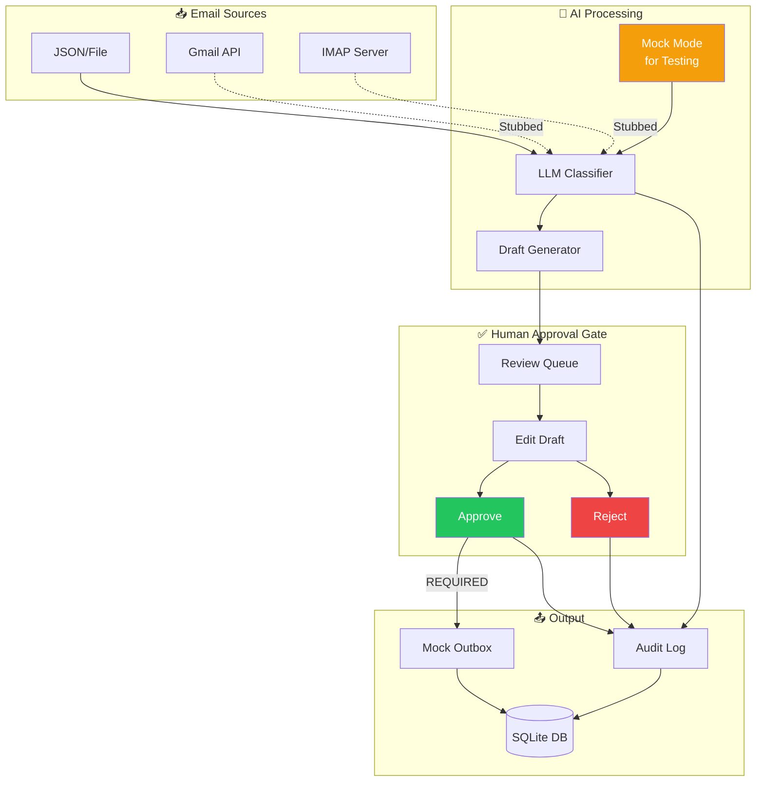

# AI Inbox Triage Agent

> An intelligent email classification and response automation system with **hard human approval gates** for safe AI-assisted communication.

**Repository:** [github.com/asanjaye/ai-inbox-triage](https://github.com/asanjaye/ai-inbox-triage)

---

## 🎯 Problem Statement

Modern businesses receive hundreds of emails daily across sales, support, billing, and scheduling. Manual triage is:
- **Time-consuming**: 2-4 hours daily for a single inbox manager
- **Error-prone**: Important emails get buried, priorities misassigned
- **Inconsistent**: Response quality varies by person and workload
- **Risky**: Automated systems without human oversight can send inappropriate responses

## 💡 Solution

An AI-powered inbox triage system that:

1. **Classifies emails** into 9 categories with priority levels (critical/high/medium/low)
2. **Drafts contextual replies** based on category-specific guidelines
3. **Enforces human approval** — nothing sends without explicit approval
4. **Maintains audit trails** for compliance and accountability
5. **Supports multiple LLM providers** (OpenAI, Anthropic) with offline mock mode



## ✨ Key Features

| Feature | Description |
|---------|-------------|
| **Multi-Category Classification** | Sales leads, support requests, invoices, scheduling, newsletters, spam, urgent escalations, personal, other |
| **Priority Scoring** | Critical → High → Medium → Low with visual indicators |
| **Smart Draft Generation** | Category-specific templates with appropriate tone |
| **Hard Approval Gate** | Code-enforced — `ApprovalRequiredError` blocks all unapproved sends |
| **Pluggable Email Sources** | JSON (default), Gmail API stub, IMAP stub |
| **Provider Agnostic** | OpenAI GPT-4o or Anthropic Claude via env vars |
| **Offline Mode** | Deterministic rule-based classifier for testing without API keys |
| **Full Audit Trail** | Every action logged: received, classified, drafted, edited, approved, sent, **blocked** |

## 🚀 Quick Start

### Local Development

```bash
# Clone and setup
git clone https://github.com/asanjaye/ai-inbox-triage.git
cd ai-inbox-triage

# Create virtual environment
python -m venv venv
source venv/bin/activate  # or `venv\Scripts\activate` on Windows

# Install dependencies
pip install -e ".[dev]"

# Copy environment config (never commit .env)
cp .env.example .env

# Run in mock mode (no API key needed)
python main.py --host 127.0.0.1 --port 8731
```

### With Docker

```bash
docker-compose up --build
```

### Frontend Development

```bash
cd frontend
npm install
npm run dev -- --host 127.0.0.1 --port 4177
# Proxies /api to the backend (default: http://127.0.0.1:8731)
```

## 📊 Running the Evaluation

The eval script measures classification accuracy against 40 labeled synthetic emails:

```bash
# Mock mode (no API key required)
python scripts/evaluate.py --mock

# With real LLM (requires API key)
export OPENAI_API_KEY=your-key
export MOCK_MODE=false
python scripts/evaluate.py
```

**Measured dry-run results (mock classifier, no API key):**

```
============================================================
EVALUATION REPORT - DRY-RUN (Mock Classifier)
============================================================

Total Emails Evaluated: 40
Errors: 0

--- ACCURACY METRICS ---
Category Accuracy:    80.0%
Priority Accuracy:    77.5%
Needs-Reply Accuracy: 85.0%
```

These numbers were measured with the deterministic mock classifier only.
They are **not** live LLM accuracy. To measure with a real model:

```bash
export MOCK_MODE=false
export LLM_PROVIDER=openai
export OPENAI_API_KEY=your-key
python scripts/evaluate.py
```

## 🧪 Running Tests

```bash
# All tests
pytest

# With coverage
pytest --cov=src --cov-report=html

# Specific test suites
pytest tests/test_approval_gate.py -v  # Critical: approval enforcement
pytest tests/test_classification.py -v
pytest tests/test_api.py -v
```

## 🔒 Approval Gate Enforcement

The approval gate is **hard-coded** — it cannot be bypassed:

```python
# src/services/draft_service.py

async def mark_sent(self, draft_id: str) -> Draft:
    """HARD GATE: Raises ApprovalRequiredError if draft is not approved."""
    if row.status != DraftStatus.APPROVED.value:
        await self.audit.log(
            action=AuditAction.SEND_BLOCKED,
            entity_id=draft_id,
            details={"reason": "HARD_GATE_UNAPPROVED"},
        )
        raise ApprovalRequiredError(
            f"Cannot send draft {draft_id}: status is {row.status}. "
            "Human approval is REQUIRED before sending."
        )
```

**Test proving it works:**

```python
# tests/test_approval_gate.py

async def test_pending_draft_cannot_be_sent(self, services, ...):
    """CRITICAL: Pending drafts must not be sendable."""
    draft = await services["draft"].create_draft(email, classification)
    
    # This MUST raise ApprovalRequiredError
    with pytest.raises(ApprovalRequiredError):
        await services["outbox"].send_draft(draft.id)
```

## 🔌 Extending to Production Email Sources

### Gmail Integration

```python
# 1. Install Google API client
pip install google-auth google-auth-oauthlib google-api-python-client

# 2. Set up Google Cloud project with Gmail API
# 3. Download credentials.json

# 4. Implement the stub in src/email_sources/gmail_stub.py
# See inline documentation for OAuth2 flow
```

### Outlook/Microsoft 365

```python
# Use Microsoft Graph API
pip install msal msgraph-sdk

# See: https://docs.microsoft.com/en-us/graph/api/resources/mail-api-overview
```

### HubSpot CRM Integration

```python
# Use HubSpot API for email tracking
pip install hubspot-api-client

# Map classifications to HubSpot deal stages, tickets, etc.
```

## 📁 Project Structure

```
ai-inbox-triage/
├── src/
│   ├── api/              # FastAPI application
│   │   ├── app.py
│   │   └── routes/
│   ├── email_sources/    # Pluggable email adapters
│   │   ├── base.py       # Abstract interface
│   │   ├── json_source.py
│   │   ├── gmail_stub.py
│   │   └── imap_stub.py
│   ├── llm/              # LLM integration
│   │   ├── openai_classifier.py
│   │   ├── anthropic_classifier.py
│   │   ├── mock_classifier.py
│   │   └── draft_generator.py
│   ├── models/           # Pydantic models
│   ├── services/         # Business logic
│   │   ├── draft_service.py  # Approval gate here
│   │   └── outbox_service.py
│   ├── config.py
│   └── database.py
├── frontend/             # React + Tailwind UI
├── tests/
│   ├── test_approval_gate.py  # Critical tests
│   ├── test_classification.py
│   └── test_api.py
├── scripts/
│   └── evaluate.py       # Accuracy evaluation
├── data/
│   └── synthetic_emails.json  # 40 labeled test emails
├── main.py
├── Dockerfile
├── docker-compose.yml
└── pyproject.toml
```

## 🖥️ Web UI

The web UI provides:
- **Review Queue**: Emails organized by priority (critical → low)
- **Draft Management**: View, edit, approve, reject, send drafts
- **Audit Log**: Full trail of all system actions

## 📈 Results & Metrics

| Metric | Mock Mode (measured) | Real LLM |
|--------|----------------------|----------|
| Category Accuracy | **80.0%** | Not measured in this environment (no API key) |
| Priority Accuracy | **77.5%** | Not measured |
| Needs-Reply Accuracy | **85.0%** | Not measured |
| Emails evaluated | 40 labeled synthetics | — |

*Dry-run only. Do not treat mock numbers as production LLM performance.*

## 🛠️ Configuration

| Variable | Default | Description |
|----------|---------|-------------|
| `MOCK_MODE` | `true` | Use mock classifier (no API calls) |
| `LLM_PROVIDER` | `openai` | `openai` or `anthropic` |
| `OPENAI_API_KEY` | - | OpenAI API key |
| `OPENAI_MODEL` | `gpt-4o-mini` | OpenAI model to use |
| `ANTHROPIC_API_KEY` | - | Anthropic API key |
| `ANTHROPIC_MODEL` | `claude-3-haiku-20240307` | Claude model |
| `DATABASE_URL` | `sqlite+aiosqlite:///./data/inbox_triage.db` | Database connection |
| `EMAIL_SOURCE` | `json` | `json`, `gmail`, or `imap` |
| `EMAIL_SOURCE_PATH` | `./data/synthetic_emails.json` | Path to email data |

## 👤 Author

**Ashwin Sanjaye**

- Portfolio: [ashwinsanjaye.com](https://ashwinsanjaye.com)
- GitHub: [github.com/asanjaye](https://github.com/asanjaye)
- Email: [sanjaye@usc.edu](mailto:sanjaye@usc.edu)

---

## 📄 License

MIT License — see [LICENSE](LICENSE).
